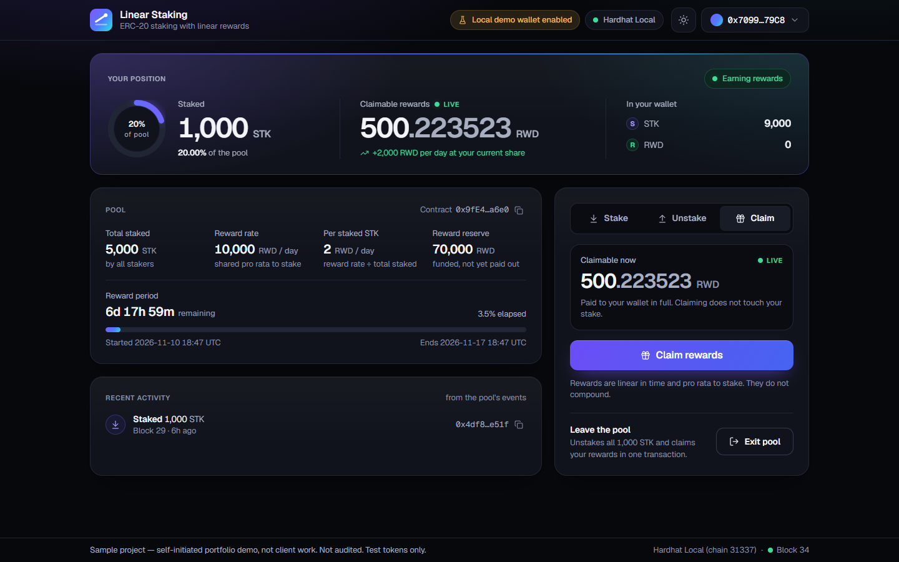

# Linear Staking dApp

> **Sample project — self-initiated portfolio demo, not client work. Not audited. Test tokens only.**

An ERC-20 staking pool with linear, time-based rewards, plus the front end to use it.
Users deposit a staking token and earn a reward token every second, in proportion to their
stake, without compounding. The owner funds reward periods (an amount spread over a
duration); funding during a running period rolls the unspent rewards into the new one.

- **Contracts:** Solidity 0.8.38, OpenZeppelin Contracts 5.6, Hardhat 3.
- **Tests:** 95 Hardhat tests (TypeScript + Solidity fuzz/invariant), a mutation check, a
  coverage report and a gas report. The numbers are [below](#test-results).
- **Front end:** Next.js 16, TypeScript, wagmi, viem, RainbowKit, Tailwind CSS, on a small
  [design system](#design-system) with a dark and a light theme. Runs against a local
  Hardhat node out of the box; Sepolia is a matter of environment variables.



## Contents

- [Repository layout](#repository-layout)
- [Quick start](#quick-start)
- [How the rewards work](#how-the-rewards-work)
- [Contract behaviour](#contract-behaviour)
- [Security notes](#security-notes)
- [Known limits](#known-limits)
- [Test results](#test-results)
- [Front end](#front-end)
- [Design system](#design-system)
- [Sepolia, Etherscan, Vercel](#sepolia-etherscan-vercel-not-executed)
- [Verification status](#verification-status)
- [Known issues and shortcuts](#known-issues-and-shortcuts)

## Repository layout

```
contracts/LinearStaking.sol      the staking pool
contracts/mocks/                 test-only: MockERC20, fee-on-transfer token, reentrant token, test harness
test/*.test.ts                   TypeScript tests (node:test + viem), incl. the randomized invariant test
test/solidity/*.t.sol            Solidity fuzz and invariant tests (forge-std, run by Hardhat 3)
test-helpers/                    fixtures, the exact reference model, shared invariant assertions
ignition/                        Hardhat Ignition modules and parameters for Sepolia (not executed)
scripts/                         local deploy + seed, ABI export, mutation check, one-command browser check
frontend/                        Next.js app (own package.json and lockfile)
docs/                            deployment guide, case study, screenshots
```

## Quick start

Requirements: Node.js and npm, Google Chrome only for the browser check.
The Hardhat workspace needs Node.js 22.13 or newer (a Hardhat 3 requirement); see
[the note on older Node.js versions](#nodejs-older-than-2213). The front end needs 20.9 or newer.

All commands run from the repository root.

```bash
# 1. Install (two packages: the Hardhat workspace and the front end)
npm ci
npm ci --prefix frontend

# 2. Compile and test the contracts
npm run compile
npm test                 # Solidity fuzz/invariant tests, then the TypeScript tests
npm run coverage         # same tests with coverage; HTML report in coverage/html
npm run gas              # same tests with gas statistics per function

# 3. Run the demo locally (two terminals)
npx hardhat node         # terminal 1: local chain on http://127.0.0.1:8545, a block every 2 s
npm run deploy:local     # terminal 2: deploy + seed, writes frontend/.env.local
npm run frontend:dev     # terminal 2: front end on http://localhost:3104
```

`npm run deploy:local` deploys two mock tokens (STK to stake, RWD as reward) and the pool,
gives four of the node's test accounts 10,000 STK each, funds a reward period of 70,000 RWD
over 7 days, and stakes 4,000 STK from two of the accounts so the pool is not empty. In the
front end choose **Connect Wallet → Local Demo Wallet** (see [Front end](#front-end)).
Restarting the node wipes the chain: run `npm run deploy:local` again afterwards.

More commands:

```bash
npm run typecheck        # compile, then type-check tests and scripts against the generated ABIs
npm run test:solidity    # only the Solidity tests
npm run test:ts          # only the TypeScript tests
npm run test:mutation    # mutation check (about 12 minutes)
npm run frontend:check   # front end: type-check, lint, unit tests, production build
npm run demo:e2e         # full browser check; also regenerates docs/screenshots/*.png
```

`npm run demo:e2e` starts its own node and web server (ports 8545 and 3104 must be free),
deploys, builds the front end, drives it in headless Chrome, and stops everything again.
It takes a few minutes. What it checks is listed under
[Verification status](#verification-status).

### Node.js older than 22.13

Hardhat 3 and its native EVM refuse to run on Node.js below 22.13. This sample was built
on a machine whose system Node.js is 20.20.2, so the root `postinstall` script
([scripts/bootstrap-node.mjs](scripts/bootstrap-node.mjs)) handles that case: on an older
Node.js it installs a pinned Node.js 22 binary and the matching EVM binding **inside
`node_modules`** (`--no-save`, nothing global, lockfile untouched). `npm run ...` and
`npx hardhat ...` put `node_modules/.bin` first on the PATH and therefore use it. On Node.js
22.13 or newer the script does nothing. Set `SKIP_LOCAL_NODE=1` to opt out and manage Node.js
yourself (nvm, fnm, Volta).

## How the rewards work

The pool uses the reward-per-token accumulator known from Synthetix `StakingRewards`.
Nothing loops over stakers; every call does a constant amount of work.

```
rewardRate       r        = R / D                         R: rewards scheduled, D: duration in seconds
rewardPerToken   A(t1)    = A(t0) + r * (t1 - t0) / S     while the total stake S is constant and > 0
earned(u)                 = settled(u) + stake(u) * (A - A_checkpoint(u))
```

`A` is updated before every change of `S`, and an account is settled before every change of
its stake, so both formulas hold piecewise between interactions. Rewards are linear in time,
proportional to stake, and unclaimed rewards earn nothing (no compounding).

**Example (the local demo):** 70,000 RWD over 7 days is 10,000 RWD per day. An account
holding 1,000 of 5,000 staked STK owns 20% and earns 2,000 RWD per day, so 500 RWD in six
hours. The browser check asserts exactly that: between 500 and 501 RWD on screen six hours
after staking, and still counting.

### Fixed-point scales

| Value | Unit | Scale | Why |
| --- | --- | --- | --- |
| `rewardRate`, `unallocatedRewards` | reward wei per second / reward wei | × 1e18 | a 6- or 8-decimal reward token over a long period would otherwise truncate to a coarse rate |
| `rewardPerToken` accumulator | reward wei per staked wei | × 1e36 | a small rate divided by a large stake would otherwise truncate to zero |

The second point is tested: with a 6-decimal reward token, 1,000,000 staked 18-decimal
tokens and an update every minute, an accumulator scaled by the usual 1e18 would pay
nothing at all; this contract is within one unit of the exact amount.

### Funding and top-ups

`fundRewards(amount, duration)` pulls `amount` reward tokens from the owner and starts a
period that lasts `duration` seconds from now:

```
rewardRate = (amount + remainingSeconds * oldRate + unallocated) / duration
```

- `remainingSeconds * oldRate` is what a still-running period has not emitted yet. A top-up
  therefore re-paces the remaining rewards together with the new ones; rewards that have
  already accrued are not affected.
- `unallocated` collects two things that would otherwise be lost: the emissions of seconds
  in which nothing was staked, and the sub-wei remainder of the rate division. Both are
  added to the next period.
- Durations must be between 1 hour and 5 years.

### Solvency, also when both tokens are the same

- Principal and rewards live in separate ledgers: `totalStaked` and
  `rewardReserve() = totalRewardsFunded - totalRewardsPaid`. Rewards are never derived from
  `balanceOf(address(this))`, so staked tokens cannot be mistaken for rewards.
- A reward rate is only ever set from tokens pulled in the same `fundRewards` call plus
  rewards funded earlier and not yet emitted. There is no way to schedule rewards without
  transferring them.
- A payout larger than the reserve reverts (`RewardExceedsReserve`). This is unreachable
  unless the reward maths is wrong; the tests reach it through a harness that corrupts the
  ledger, and show that even then principal cannot be paid out as rewards.
- After every inbound transfer (`stake`, `fundRewards`) the pool checks that it holds at
  least what it owes in that token: principal for the staking token, the reserve for the
  reward token, and **both** when they are the same token (`InsufficientTokenBalance`).
- All rounding is down, in favour of the pool.

The invariants `sum of stakes == totalStaked`, `paid <= funded`,
`reserve >= accrued + still to be emitted + unallocated` and
`token balance >= principal + reserve` are asserted after every step of the randomized
tests, for two-token pools and for single-token pools.

### Overflow bound

Lifetime funding is capped at `2^128 - 1` reward wei. Every intermediate value of the reward
maths is bounded by `totalRewardsFunded * 1e36 < 2^128 * 1e36 < 2^256`, so the reward maths
cannot overflow and can therefore never block `unstake`. A test funds the cap over the
shortest period with a single wei staked, and the Solidity fuzz tests cover stakes up to
`2^128 - 1` and rewards up to the cap.

## Contract behaviour

| Call | Who | Behaviour |
| --- | --- | --- |
| `stake(amount)` | anyone | Pulls `amount` staking tokens (needs approval). Reverts for zero, and while paused. |
| `unstake(amount)` | staker | Returns part or all of the stake; accrued rewards stay claimable. Reverts for zero and for more than is staked. **Never pausable.** |
| `claim()` | staker | Pays all accrued rewards. Reverts while paused. |
| `exit()` | staker | `unstake(everything)` + `claim()` in one transaction. Reverts while paused. |
| `fundRewards(amount, duration)` | owner | Pulls reward tokens and starts / re-paces a reward period. |
| `pause()` / `unpause()` | owner | Emergency stop for `stake`, `claim` and `exit`. |
| `transferOwnership` / `acceptOwnership` | owner / nominee | Two-step ownership transfer. |
| `earned(account)`, `rewardPerToken()`, `rewardReserve()`, ... | anyone | Views. |

Decisions that are easy to get wrong, each covered by a test:

- **`claim()` with nothing accrued is a no-op:** it returns 0, transfers nothing, emits
  nothing and does not revert. A second claim right after the first one is harmless.
- **`exit()` with nothing staked reverts** with `ZeroAmount`, like `unstake(0)`. Rewards left
  over after unstaking are collected with `claim()`.
- **Zero amounts revert** (`ZeroAmount`); unstaking more than staked reverts with
  `InsufficientStake(requested, available)`.
- **While paused,** rewards keep accruing, `unstake` works, and rewards earned before or
  during the pause are claimable once the pool is unpaused.
- **`renounceOwnership()` is blocked while paused,** because an ownerless paused pool could
  never be unpaused and all unclaimed rewards would be locked.
- Every state change emits an event: `Staked`, `Unstaked`, `RewardPaid`, `RewardsFunded`,
  and OpenZeppelin's `Paused`, `Unpaused`, `OwnershipTransferStarted`, `OwnershipTransferred`.

## Security notes

**Not audited; an independent audit is recommended before mainnet.** This is sample code
written to show how I approach staking logic. Do not deploy it with real funds as it is.

What is in place:

- Checks-effects-interactions in every function; token transfers are the last step. Two
  tests observe the pool from inside a hostile token's transfer and see final state.
- OpenZeppelin `ReentrancyGuardTransient` on every function that moves tokens. A malicious
  token mock that re-enters from its own `transfer` / `transferFrom` is rejected on `stake`,
  `unstake`, `claim`, `exit` and `fundRewards`.
- `SafeERC20` for all transfers, custom errors, `Ownable2Step`, `Pausable`.
- Separate ledgers and a post-transfer balance check instead of trusting token balances.
- A stated overflow bound instead of `unchecked` arithmetic: the pool contract has no
  `unchecked` block.

Trust assumptions:

- The owner can pause and unpause, which stops claims as well as new stakes. Principal can
  always be withdrawn.
- The owner can re-pace funded rewards by calling `fundRewards` again (for example one wei
  over five years slows the emission down). The owner cannot withdraw staked tokens or
  funded rewards: the contract has no function that sends tokens to the owner.
- The token addresses are fixed at deployment. A malicious or broken token breaks any pool
  built on it.

## Known limits

- **Fee-on-transfer tokens are not supported.** `stake` and `fundRewards` revert when a
  transfer leaves the pool holding less than it owes.
- **Rebasing tokens are not supported** and cannot be detected. Do not use them.
- **Tokens sent directly to the pool** (not through `stake` or `fundRewards`) are ignored by
  the accounting and cannot be recovered. There is no rescue function.
- **Rounding dust:** each settlement of an account rounds its rewards down by less than one
  wei of reward token; each accumulator update truncates by less than `totalStaked / 1e36`
  wei (nothing for any realistic stake). The dust stays in the pool. In the randomized tests
  the largest gap between the contract and an exact rational model was 7 wei per account, and
  the most dust left in a pool after everyone had left was 18 wei.
- **Rewards emitted while nothing is staked** are not lost, but they are only released again
  by the next `fundRewards` call. If the owner never funds again, they stay in the pool.
- **No lock-up and no minimum staking time.** An account that stakes just before a period is
  funded shares it like everyone else.
- **Lifetime funding cap** of `2^128 - 1` reward wei (about 3.4e20 whole tokens at 18
  decimals).
- **EVM version:** the reentrancy guard uses transient storage (EIP-1153), so the target
  chain must support the Cancun opcodes.

## Test results

Measured on 2026-11-10 with Hardhat 3.21.2, solc 0.8.38 (optimizer on, 200 runs, EVM
`cancun`), on Windows 10 with the project-local Node.js 22.23.4.

```
$ npm test
95 passing (13 solidity, 82 nodejs)
```

| Suite | Tests | What it covers |
| --- | --- | --- |
| `test/LinearStaking.core.test.ts` | 22 | deployment; stake / unstake / claim / exit happy paths with events and balances; zero amounts; unstaking too much; the no-op second claim |
| `test/LinearStaking.rewards.test.ts` | 13 | linear accrual checked at nine timestamps; stop at period end; pro rata between stakers who join, top up, leave and claim at different times, against the exact reference model; no compounding; 6-decimal reward precision; dust; rewards without stakers |
| `test/LinearStaking.funding.test.ts` | 19 | owner only; amount and duration validation; top-up maths; the rate never promises more than the pool holds, including the same-token case; fee-on-transfer tokens; reserve guard; lifetime cap at the overflow bound |
| `test/LinearStaking.admin.test.ts` | 11 | pause behaviour; two-step ownership; renouncing |
| `test/LinearStaking.reentrancy.test.ts` | 9 | hostile staking token, hostile reward token, hostile owner; state seen from inside a transfer |
| `test/LinearStaking.invariants.test.ts` | 3 | randomized sequences, see below |
| `test/Ignition.test.ts` | 4 | the deployment modules |
| `test/Gas.test.ts` | 1 | gas benchmark with regression ceilings |
| `test/solidity/LinearStaking.fuzz.t.sol` | 5 | fuzzed reward maths over the whole numeric range, 1,000 runs each |
| `test/solidity/LinearStaking.invariant.t.sol` | 8 | four invariants on a two-token and a single-token pool; 64 runs of 100 random calls each, any unexpected revert fails |

**Reference model and tolerance.** The expected values do not come from the contract's own
formula. [test-helpers/reference.ts](test-helpers/reference.ts) walks the timeline and hands
each staker `rate * dt * stake / totalStake` per interval, using exact fractions of BigInts
(no accumulator, no fixed point, no rounding). The stated tolerance is: per account, the
contract may be below the exact value by at most one wei per settlement of that account plus
two wei, and never more than one wei above it.

**Randomized invariant test.** Three pool types (two tokens; one token for both; 18-decimal
stake with 6-decimal rewards), 20 sequences of 60 random steps each, 3,600 steps in total:
stake, unstake, claim, exit, fund / top up, pause, and time jumps from one second to three
days, by four accounts. The invariants listed above, the comparison with the reference model
and "unstake never fails, paused or not" are asserted after every step. The run is
deterministic; `FUZZ_SEED`, `FUZZ_RUNS` and `FUZZ_STEPS` change the seed and the size.

### Coverage

```
$ npm run coverage
║ File Path                   │ Line % │ Statement % │ Uncovered Lines ║
║ contractsLinearStaking.sol │ 100.00 │ 100.00      │ -               ║
║ Total                       │ 100.00 │ 100.00      │                 ║
```

86 of 86 instrumented lines are hit (`coverage/lcov.info`).

Mocks and the test harness are excluded. Hardhat 3.21's built-in coverage reports lines
and statements only, not branches; the mutation check below is the stronger evidence that
the conditions are tested.

### Mutation check

```
$ npm run test:mutation
Mutation check: 30 of 30 mutants killed.
```

[scripts/mutation-check.mjs](scripts/mutation-check.mjs) applies 30 hand-written bugs to the
contract, one at a time (a guard removed, a formula changed, an accounting step dropped),
and runs the test suite against each. Every one of them makes at least one test fail. To
keep the check at about 12 minutes the randomized TypeScript test runs 5 instead of 20
sequences per pool type; its seeds are fixed, so that is a subset of the normal run. The
list of mutants is in the script. It is a spot check written for this contract, not an
exhaustive mutation tool.

### Gas

Steady-state numbers from `test/Gas.test.ts`: a two-token pool with a running reward
period and other stakers in it, `gasUsed` of real transactions.

| Call | Scenario | Gas |
| --- | --- | ---: |
| `stake` | first stake of an account | 113,302 |
| `stake` | adding to an existing stake | 99,002 |
| `unstake` | partial | 93,262 |
| `unstake` | full | 71,362 |
| `claim` | first claim (account receives the reward token for the first time) | 108,923 |
| `claim` | later claim | 77,299 |
| `exit` | full stake + first reward payout | 129,990 |
| `fundRewards` | first period | 179,372 |
| `fundRewards` | top-up of a running period | 83,271 |

Over all calls made by the test suite (`npm run gas`, which also counts the randomized
tests and their zero-reward claims; the Solidity fuzzer picks new inputs on every run, so
these figures move slightly from run to run):

| Function | Min | Average | Median | Max | Calls |
| --- | ---: | ---: | ---: | ---: | ---: |
| `stake` | 67,285 | 95,770 | 96,166 | 146,167 | 1,056 |
| `unstake` | 49,236 | 78,635 | 76,162 | 144,682 | 463 |
| `claim` | 38,089 | 62,455 | 51,930 | 165,023 | 852 |
| `exit` | 51,242 | 88,314 | 86,712 | 189,082 | 293 |
| `fundRewards` | 75,028 | 102,157 | 83,247 | 184,630 | 539 |

Deployment: 1,164,291 gas, 4,997 bytes of runtime bytecode.

Storage is deliberately not packed. Most of the difference between a first and a later
call is a storage slot going from zero to non-zero (20,000 gas): the account's stake, its
reward ledger entry after each claim, or the recipient's token balance. Packing stake and
rewards into one slot would save roughly that much on calls after a claim, at the price of
narrowing casts in the reward maths; for a sample whose point is correctness I left it out.

## Front end

One page, composed of four parts:

- **Header:** network pill, theme toggle, and a wallet button that opens the RainbowKit
  dialogs (themed with the app's own tokens).
- **Your position** (the focal area): the staked balance with the share of the pool as a
  ring, the claimable rewards ticking live, and what is still in the wallet. Without a
  wallet it is a prompt to connect; the pool figures below are live either way.
- **Stake / Unstake / Claim** as one panel with three tabs. Each tab keeps its own input
  and its own transaction state, so switching tabs while something is pending loses nothing.
- **Pool** (four figures and the reward period as a progress bar with the time remaining)
  and **Recent activity** (the connected account's last `Staked`, `Unstaked` and
  `RewardPaid` events, read from the contract's logs).

Behaviour:

- **Live rewards.** The chain is re-read on a short interval. Between two reads the page
  interpolates with the contract's own formula (stopping at the end of the period) on every
  animation frame, on a clock that follows the chain's block timestamps. Each new block is
  reconciled: a small difference glides in, the number never runs backwards on timing
  jitter, and a claim or an exit is shown at once. Between blocks it is an estimate, with
  the tolerance described under [Known issues](#known-issues-and-shortcuts).
- **Stake** with validation (number format, decimals, zero, more than the balance) and the
  approve-then-stake flow as a two-step indicator: needs approval, confirm in wallet,
  pending, done, failed. One button performs whichever step is still missing; the approval
  is for exactly the amount entered. The form previews stake, share and daily rewards after
  the transaction.
- **Every transaction** shows its state next to its button: waiting for the wallet, pending
  with its hash, confirmed with the block number, or failed with a readable reason and
  "Try again". Calls are simulated first, so a revert is reported with the decoded custom
  error instead of being sent. A confirmation also raises a toast.
- **A disabled button says why** in its own label: "Enter an amount", "Not enough STK",
  "Nothing to claim yet", "Staking is paused", "Connect a wallet to stake".
- **States:** no wallet, wrong network (with a switch button), paused pool, zero balance,
  zero rewards, reward period ended or never funded, node unreachable (also after the page
  has loaded: the last values stay, marked as stale), missing contract, missing
  configuration. Skeletons with the shape of the page while the first read is in flight.
- **Accessibility:** everything is reachable by keyboard with a visible focus, the tabs
  follow the ARIA tab pattern (arrow keys), transaction states and toasts are announced
  (`aria-live`), and no state is carried by colour alone (each has its own icon and words).
  `prefers-reduced-motion` switches off every animation and counting number; the rewards
  figure is then refreshed once a second.
- The honesty label is in the footer, which stays on screen from tablet width up. No fonts,
  scripts or other assets are loaded from a CDN at run time; during the browser check the
  page contacted no host other than itself and the local node.

Every figure on the page is read from the chain or derived from what was read:

| Figure | Source |
| --- | --- |
| Staked, wallet balances, allowance, claimable rewards at a block | `stakedBalance`, `balanceOf`, `allowance`, `earned` |
| Claimable rewards between blocks | `earned + stake * rewardRate * dt / totalStaked`, `dt` capped at `periodFinish` |
| Share of the pool | `stakedBalance / totalStaked` |
| Rewards per day at your share | `rewardRate * 86,400 * stake / totalStaked` |
| Total staked, reward reserve | `totalStaked`, `rewardReserve` |
| Reward rate per day | `rewardRate * 86,400` |
| Per staked STK per day | `rewardRate * 86,400 / totalStaked`. Reward tokens per staking token; not an APR, the two tokens have no price |
| Time remaining, end of the period | `periodFinish` against the chain clock |
| Start of the period, share elapsed | `duration` of the `RewardsFunded` event that set this `periodFinish`. Not shown if that event is not found |

### Configuration

Network and contract address come from environment variables
([frontend/.env.example](frontend/.env.example)); there is nothing to change in the code to
move from the local node to Sepolia. The token addresses, symbols and decimals are read
from the pool contract.

| Variable | Meaning |
| --- | --- |
| `NEXT_PUBLIC_CHAIN_ID` | `31337` (local Hardhat node, default) or `11155111` (Sepolia) |
| `NEXT_PUBLIC_RPC_URL` | JSON-RPC endpoint; defaults to `http://127.0.0.1:8545` locally and to the chain's public endpoint on Sepolia |
| `NEXT_PUBLIC_STAKING_ADDRESS` | the `LinearStaking` contract |
| `NEXT_PUBLIC_ENABLE_DEMO_WALLET`, `NEXT_PUBLIC_DEMO_WALLET_ADDRESS` | local demo wallet, see below |
| `NEXT_PUBLIC_WALLETCONNECT_PROJECT_ID` | optional; without it only browser-extension wallets are offered |

`npm run deploy:local` writes `frontend/.env.local` for the local demo. The ABI in
`frontend/src/contracts/linearStakingAbi.ts` is generated from the compiled contract with
`npm run export-abi` and committed, so the front end builds on its own.

### The Local Demo Wallet is for local demo only

To make the demo (and the browser check) work without a wallet extension, the connect dialog
offers a **Local Demo Wallet** when `NEXT_PUBLIC_ENABLE_DEMO_WALLET=true`. It is wagmi's
`mock` connector wrapped as a RainbowKit wallet
([frontend/src/config/demoWallet.ts](frontend/src/config/demoWallet.ts)): it acts as one of
the Hardhat node's built-in, publicly known test accounts and forwards transactions to the
node, which signs for its own test accounts. No private key is in the front end or in this
repository. **This connector is for the local demo only.** It cannot work against a real
network, and the app ignores the flag on any chain other than 31337. While it is on offer,
the header says "Local demo wallet enabled" at every width; without the flag neither that
indicator nor the wallet is in the page.

### Screenshots

All eight are taken by `npm run demo:e2e`
([frontend/e2e/demo-flow.mjs](frontend/e2e/demo-flow.mjs)) from the production build running
against the local node. The first seven are 1440×900; the last one is 390 px wide and as tall
as the page.

| File | Theme | Shows |
| --- | --- | --- |
| [01-connect-wallet.png](docs/screenshots/01-connect-wallet.png) | dark | RainbowKit dialog with the local demo wallet |
| [02-connected-balances.png](docs/screenshots/02-connected-balances.png) | dark | connected: wallet balance, stake, claimable rewards, pool figures, empty activity list |
| [03-stake-pending.png](docs/screenshots/03-stake-pending.png) | dark | step 1 approved (with its toast), stake transaction pending with its hash |
| [04-rewards-accruing.png](docs/screenshots/04-rewards-accruing.png) | dark | 1,000 STK staked (20% of the pool), about 500 RWD accrued after six hours, claim tab |
| [05-claim-confirmed.png](docs/screenshots/05-claim-confirmed.png) | dark | claim confirmed, rewards in the wallet and in the activity list |
| [06-unstake-confirmed.png](docs/screenshots/06-unstake-confirmed.png) | dark | partial unstake confirmed, three events listed |
| [07-rewards-accruing-light.png](docs/screenshots/07-rewards-accruing-light.png) | light | the connected state of 04 in the light theme |
| [08-rewards-accruing-390.png](docs/screenshots/08-rewards-accruing-390.png) | dark | the same state at 390 px: the whole page in one column |

## Design system

One file holds every design decision:
[frontend/src/app/tokens.css](frontend/src/app/tokens.css). It defines CSS custom properties
and wires them into Tailwind (`@theme`), with Tailwind's default palette, radii, shadows
and type sizes switched off. Components can therefore only use what the file defines
(`bg-surface`, `text-ink-2`, `rounded-lg`, `shadow-card`, `text-display`).

| Token group | What it holds |
| --- | --- |
| Neutrals | page, three surface levels, two line strengths, four text strengths |
| Accent | one violet family, and one signature gradient (violet, blue, aqua) used sparingly: the logo and the account dot, the primary button, the progress graphics, and a hairline and a soft glow on the position card |
| Semantic | success, pending / warning, error: each as text colour, tinted background and border |
| Depth | layered soft shadows for cards, pop-overs and the primary button; a glow for focus and the active step |
| Shape and space | five radii; one 4 px spacing unit |
| Type | seven sizes from 11 px labels to 44 px figures, each with line height and tracking |
| Motion | 150, 200 and 250 ms; one easing for state changes, one for entrances |

- **Themes.** Dark is the primary look; the light theme is the same tokens with other
  values. The toggle in the header stores the choice (`localStorage`); without one the
  operating system's preference decides. An inline script in `<head>` applies the theme
  before the first paint, so there is no flash on load.
- **Typography.** [Geist](https://vercel.com/font) Sans, a variable font, for the interface
  and every number; Geist Mono only for addresses and hashes. Both ship in the `geist` npm
  package and are served from the app's own origin through `next/font/local`. Tabular
  figures are on for the whole page, so no number changes width while it counts.
- **Icons** are inline SVG in one file
  ([frontend/src/components/icons.tsx](frontend/src/components/icons.tsx)).
- **Contrast.** [tokens.test.ts](frontend/src/app/tokens.test.ts) parses the stylesheet and
  checks every text / background pair of both themes against WCAG AA (4.5:1 for text, 3:1
  for graphics that carry meaning), including text on top of the glows at their strongest
  point. The browser check runs axe-core (WCAG 2.1 A and AA) on the page in both themes.
- **Motion.** Transitions of 150 to 250 ms, numbers that count to their new value, a tick
  that draws itself when a transaction confirms. All of it is off under
  `prefers-reduced-motion`.

## Sepolia, Etherscan, Vercel: NOT EXECUTED

No keys, RPC endpoints or accounts were available, and none were created, so nothing was
deployed to a public network, verified on an explorer or hosted. The repository is prepared
for it: a `sepolia` network and Etherscan settings in `hardhat.config.ts` that read their
secrets from the Hardhat keystore or a git-ignored `.env`, two Ignition modules, and a
written procedure in [docs/deployment.md](docs/deployment.md). The Ignition modules
themselves were run on the in-memory chain and, with the same CLI command, on a local node.

## Verification status

Everything in the first table was run on Windows 10 (system Node.js 20.20.2, npm 10.8.2;
Hardhat on the project-local Node.js 22.23.4; Chrome 157) and the result was read from the
actual output. The contract rows were run on 2026-11-10. On 2026-11-11 the front end was
redesigned, without touching the contracts, their tests or the deployment scripts; the rows
dated 2026-11-11 were run again after that.

| What | Command | Last run | Result |
| --- | --- | --- | --- |
| Clean install, Hardhat workspace | `npm ci` | 2026-11-10 | ok, including the Node.js 22 bootstrap |
| Compile and type-check tests and scripts | `npm run typecheck` | 2026-11-10 | ok (solc prints one known warning, see below) |
| Contract tests | `npm test` | 2026-11-11 | 95 passing (13 Solidity, 82 TypeScript), 0 failing |
| Coverage | `npm run coverage` | 2026-11-10 | `LinearStaking.sol`: 100% lines (86/86), 100% statements |
| Gas report | `npm run gas` | 2026-11-10 | tables above |
| Mutation check | `npm run test:mutation` | 2026-11-10 | 30 of 30 mutants killed |
| Clean install, front end | `npm ci --prefix frontend` | 2026-11-11 | ok |
| Front end type-check, lint, unit tests, build | `npm run frontend:check` | 2026-11-11 | all pass; 310 unit tests in 12 files |
| Local node, deploy and seed | `npx hardhat node`, `npm run deploy:local` | 2026-11-11 | ok |
| Front end dev server | `npm run frontend:dev` | 2026-11-11 | serves on `localhost:3104` and `127.0.0.1:3104`; the browser check below also passes against it |
| Browser check against the local node | `npm run demo:e2e` | 2026-11-11 | pass, see below; eight screenshots written |
| Ignition modules | `test/Ignition.test.ts`; `hardhat ignition deploy ... --network localhost` | 2026-11-10 | pass; both modules deployed on a local node |

`npm run demo:e2e` drives the production build in headless Chrome and asserts, in this order:

- **Flows:** pool figures without a wallet; connect through the dialog; amount validation
  with its messages; approve, then stake, with the state of both steps (pending and
  confirmed); about 500 RWD after six hours, a new value on every frame and none lower than
  the one before across two blocks; claim; partial and MAX unstake; exit. After each
  transaction: balances, the entry in the activity list, the toast.
- **A failed transaction:** the pool is paused at the moment of staking; the page names the
  reason, sends nothing, and "Try again" succeeds once the pool is open again.
- **States:** paused pool (notice; stake, claim and exit disabled with the reason; unstake
  works), reward period ended (notice, reward rate 0), disabled buttons that say why.
- **Themes:** dark and light follow the operating system; the toggle; the choice is stored
  and applied before the app's scripts run.
- **Layout:** no horizontal overflow at 1440, 1024 and 390 px, in both themes.
- **Keyboard and motion:** the controls are reached with Tab and show a focus indicator,
  arrow keys switch tabs; under `prefers-reduced-motion` animations are off and the rewards
  figure is refreshed once a second.
- **Accessibility:** axe-core, WCAG 2.1 A and AA, on the wallet dialog, the dashboard (dark
  and light at 1440 px, dark at 390 px) and the paused pool: no violation in the app's own
  markup. One finding in RainbowKit's dialog is reported on every run, see
  [Known issues](#known-issues-and-shortcuts).
- No page error, no console error, and no request to a host other than the page's own and
  the local node.

Implemented but **not verified by running**, or verified only by hand:

| What | Status |
| --- | --- |
| Deployment to Sepolia | not executed |
| Etherscan verification (`--verify`, `hardhat verify`) | not executed |
| Hosting on Vercel | not executed |
| Front end against Sepolia | not run; only the configuration parsing is unit-tested. Event queries there reach back 50,000 blocks; that path has never run |
| Real wallets (browser extension, WalletConnect) | not exercised; every browser run used the local demo wallet. With it the "confirm in your wallet" state lasts an instant and was never looked at |
| Wrong network | seen once by hand: the demo connector was switched to another chain id from a throwaway script; the notice, the disabled buttons and the switch button worked. Not part of `demo:e2e` |
| Node unreachable, stale data, missing configuration, loading skeleton | each looked at once (requests blocked from a throwaway script; a build without `.env.local`). Not part of `demo:e2e` |
| A wallet without STK; a pool that was never funded; no contract at the configured address | implemented (a notice or an empty state each), never seen in the browser: the local demo cannot produce them |
| Demo-wallet indicator when the flag is off | checked once on the dev server with `NEXT_PUBLIC_ENABLE_DEMO_WALLET=false`: no indicator, no demo wallet in the dialog. The flag parsing is unit-tested |
| Other browsers, real phones, touch input | not run: Chrome 157 on a desktop only; 1024 and 390 px are emulated widths |
| Screen readers | not tested with one; roles, names and live regions are checked by axe-core only |
| Widths other than 1440, 1024 and 390 px | not looked at |
| Linux and macOS | not run; the scripts avoid platform-specific code except where noted in them |

## Known issues and shortcuts

- **Node.js bootstrap.** Provisioning a project-local Node.js 22 from a `postinstall`
  script is unusual. It is there so the documented commands work on the Node.js 20 machine
  this was built on; with Node.js 22.13 or newer it is inert.
- **Compiler newer than the toolchain's list.** solc 0.8.38 is the current release, while
  Hardhat 3.21.2's internal version table ends at 0.8.34. Compilation, tests, coverage and
  stack traces worked; the EVM version is pinned explicitly so nothing depends on defaults.
- **One compiler warning** is printed on every build: solc's generic notice about transient
  storage, raised by OpenZeppelin's `TransientSlot`. The reentrancy guard is the use case the
  warning itself calls safe.
- **`npm audit`** reports advisories in third-party tooling that I did not try to patch: one
  in the Hardhat workspace (`zod`, reached through Hardhat itself, counted 12 times) and 38
  in the front end (2 low, 19 moderate, 17 high; all transitive, in wallet SDKs pulled in by
  wagmi and RainbowKit and in lint tooling). npm's suggested fix is a breaking downgrade.
- **The front end is client-rendered.** RainbowKit's entry point pulls in wallet SDKs whose
  server-side entry imports optional packages that are not installed, which breaks a server
  build. The wallet stack is therefore loaded in the browser only; the server renders a
  static shell: the header, a skeleton of the page and the honesty label.
- **ESLint 9** is used (the latest 9.x) because the plugins bundled with
  `eslint-config-next` 16.4.6 were not checked against ESLint 10.
- **No CI configuration** is included, because it could not be run here.
- **The reward projection in the UI is an estimate** between two reads of the chain; it
  assumes nobody else stakes or unstakes in those seconds and is reconciled with the
  on-chain value on every read. To keep the figure from running backwards on timing jitter
  it may stay up to two seconds of accrual above that value for a moment.
- **RainbowKit's connect dialog** draws its wallet icons as `role="img"` without a text
  alternative (axe-core: `role-img-alt`). It is the library's markup and is not patched; the
  wallet's name is the text next to the icon. The browser check reports it on every run.
- **Recent activity** shows the last three events, and on any chain other than the local
  one only those of the last 50,000 blocks, because public RPC endpoints cap the range of
  `eth_getLogs`. If the `RewardsFunded` event of the running period is older than that, the
  period is shown with its time remaining but without its start and progress.
- **One screen at 1440×900** holds the whole page in its normal states; a notice (paused,
  wrong network, period ended) makes it scroll. The footer with the honesty label stays on
  screen from 640 px up; on a phone it ends the page.

## Licence

MIT, see [LICENSE](LICENSE).
